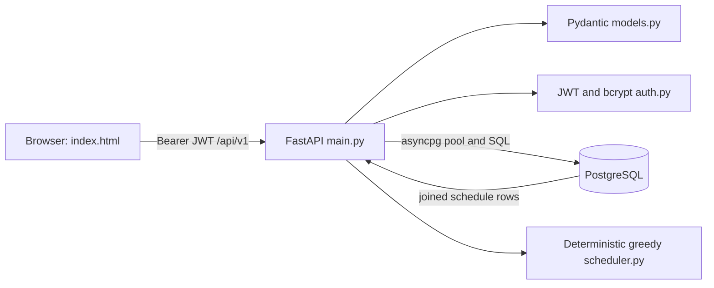

# Project overview and architecture audit

Audit date: 2026-11-03 (Asia/Qyzylorda). Baseline: `main` commit `69f906bcad45a7dc3c2310eec3a2de8a6522daf4`. Audit branch: `audit/architecture-features-ux`.

## Scope and instructions

Read `AGENTS.md`, `CODEX_START_HERE.md`, `codex-prompts/01_INITIAL_AUDIT.md` and all three `.agents/skills/{safe-frontend-refactor,timetable-ux-specialist,university-saas-design}/SKILL.md` files. The environment's original `work` branch was older (`4bd2ff8`); fetched current main and branched from it. The six incoming changes are instructions only; application files are identical between those commits. This audit covers this Git repository, not the separate multi-version OneDrive archive. Uploaded plans/reports describe intended scope and historical claims, not proof of implementation.

No application, schema, test, dependency, deployment or secret changes. No migrations, production connections, generation requests or database writes. Only the four audit Markdown documents are deliverables. Temporary verification helpers and synthetic screenshots were written outside the checkout under `/tmp`.

## Architecture

| Component | Responsibilities and evidence | Implications |
| --- | --- | --- |
| `index.html` | Single document with embedded compiled Tailwind, custom CSS, shell, native dialogs, catalogs, calendar and API client; `api` at line 748, `renderView` at 1755 | No React, bundler or client router. CSS, state, rendering and handlers are tightly coupled. |
| `main.py` | FastAPI routes, SQL, transactions and domain validation; lifespan at 78; connection dependency at 164 | Business rules and persistence share one module. FastAPI response models validate outputs. |
| `models.py` | Strict inputs, forbidden extra fields, partial-update checks, roles, duration and capacity validation | Keep contracts stable during future UI work. |
| `auth.py` | bcrypt through passlib; HS256 JWT; expiry default 60 minutes; role dependency | Authorization trusts the signed role until token expiration, without loading the current user. |
| `scheduler.py` | Stable ordering and greedy placement with occupancy, capacity, availability, duration and workload checks | Deterministic algorithm, **not AI/ML**. No backtracking or global optimum guarantee. |
| `schema.sql` | Nine tables, extensions, constraints and upgrade SQL in one transaction | Both initial schema and legacy migration; not a versioned migration system. |
| `compose.yaml`, `Dockerfile`, `start.ps1` | PostgreSQL 16 volume, Python 3.12 image, Uvicorn, first-run environment setup | Init SQL executes automatically only for a new database volume. Existing installations need explicit migration planning. |

## Persistence model

- `users`: email, bcrypt hash, admin/instructor/student role.
- `instructors`: unique user relation, active status, workload and availability limits/deadline.
- `courses`, `rooms`, `student_groups`, `time_slots`: active catalogs and domain constraints.
- `teaching_loads`: course/group/instructor assignment, delivery mode, sessions per week, duration, generated planned minutes.
- `instructor_availability`: instructor/slot status: available, unavailable, preferred.
- `schedules`: course, room, instructor, group and slot references plus creation timestamp.

There is no student-to-group user membership table, dated semester/week session, persistent draft, publication state, schedule version, lock, request, notification or change-history entity. Academic year labels belong to groups; they do not give schedules per-week date validity. Foreign keys restrict deletion of referenced records; instructor-user relation cascades subject to downstream restrictions.

`schema.sql:57` has unique resource/slot keys. `schema.sql:147` also excludes **all overlapping slot definitions on a weekday**, not just sessions sharing resources. This protects the current model but disallows independent overlapping teaching-period templates even when rooms and people differ. Treat that as a domain restriction requiring a product decision, not an accidental promise of flexible intervals.

## Routes and permissions

FastAPI also supplies `/docs`, `/redoc`, `/openapi.json`; `/` serves `index.html`.

| Routes under `/api/v1` | Methods | Access / implementation |
| --- | --- | --- |
| `/auth/login` | POST | Public credentials validation; issues JWT. |
| `/users`, `/users/{id}` | POST/GET; PATCH/DELETE | Admin. Admin deletion blocked; role changes have instructor-profile guard but no last-admin guard. |
| `/courses`, `/rooms`, `/student-groups`, `/instructors`, `/time-slots` and ID paths | POST/GET; PATCH/DELETE | Admin CRUD with domain/FK protection. |
| `/schedules` | GET | Any authenticated user. Optional group/room/instructor filters; **no ownership or role scope** (`main.py:881`). |
| `/schedules`, `/schedules/{id}` | POST; PATCH/DELETE | Admin manual create/edit/delete with conflict checks. |
| `/schedules/batch` | DELETE | Admin; body of schedule IDs, bounds and missing-record validation. |
| `/schedules/generate` | POST | Admin; computes then persists records, optionally replaces all schedules. |
| `/schedules/conflicts` | GET | Admin; capacity and room/instructor/group overlaps, not a complete policy validator. |
| `/instructors/me/availability`, `/instructors/{id}/availability` | GET/POST/PUT | Active instructor owner only, including explicit ID routes. Admin is not allowed by `_availability_owner`. |
| `/instructors/{id}/status` | PATCH | Admin. |
| `/instructors/{id}/workload` | GET/PUT | GET: admin or instructor owner. PUT: admin. |
| `/teaching-loads`, `/teaching-loads/{id}` | GET/POST; PUT/DELETE | Admin; optional instructor filter. |

### Data flow and consistency

1. Login queries the user and verifies bcrypt, returning a signed token. Browser stores it in localStorage and decodes identity for UI only. API validates signature/expiry; frontend visibility is not authorization.
2. Admin startup fetches OpenAPI and seven catalog/schedule datasets. OpenAPI enables optional forms. Failures are tracked separately from empty datasets (`index.html:1694`); unrelated working catalogs remain usable.
3. Manual schedule writes check active entities, capacity, unavailable slots, interval resource overlaps, instructor and course/group minute limits (`main.py:1166`). They do not enforce a teaching-load assignment or delivery-mode room compatibility.
4. Domain POST/PUT/PATCH/DELETE requests take one transaction-scoped advisory lock (`main.py:164`). This serializes cooperating app writers across workers; it is not an independent database guarantee for clients that bypass the app. Reads and login do not take it.
5. Generation reads explicit assignments or active stored teaching loads. It runs the pure greedy solver before writing. An infeasible result raises 422 without inserting its tentative placements. On success, nested transactional SQL inserts every generated entry. With `replace_existing=true`, it first executes `DELETE FROM schedules` (`main.py:802`). This is not a preview or versioned draft. Failure rollback semantics are visible in source but not exercised against PostgreSQL in this audit.
6. Calendar uses already-loaded recurring rows. Week arrows change headings, not server-side dated session selection. Counts represent all loaded rows.

## Dependencies and environment

Python requirements are ranges, without a Python lockfile. Important packages: FastAPI, asyncpg, Pydantic v2, passlib/bcrypt, PyJWT, httpx, pytest, anyio and uvicorn standard extras. `Depends(..., scope="function")` and other current APIs mean the effective minimum compatible FastAPI version should be tested: the broad manifest lower bound alone is not proof. Node development dependencies are Playwright (`^1.56.0`) and Tailwind CLI/CSS (`4.3.3`); no committed npm lockfile or Node version pin. Node is not required to serve the app.

Required runtime: `DATABASE_URL`, `JWT_SECRET_KEY`. Bootstrap email/password must be provided together or both omitted. Optional `ACCESS_TOKEN_EXPIRE_MINUTES` must be positive. Compose additionally reads PostgreSQL credentials and requires bootstrap values. No values or credential files were inspected for this audit.

`start.ps1:26` prints bootstrap email/password from `.env`, contradicting README's no-print claim. README refers to missing `UPDATE-V2.5.md` and `docs/UserStories.xlsx`. Do not run startup or migration commands on real installations without separate approval. Use disposable data for future integration tests.

`npm run build:css` calls `tests/embed_styles.cjs`, which rewrites tracked `index.html`. It was deliberately **not run** in this read-only audit. CSS output is already embedded; no frontend build is necessary to inspect it in Chromium.

## Executed validation and limits

| Check | Observed outcome | What this proves |
| --- | --- | --- |
| `.venv/bin/python -m pip check` | Exit 0, no broken requirements | Current installed Python dependency metadata is coherent, not reproducibility. |
| `PYTHONDONTWRITEBYTECODE=1 .venv/bin/python -m pytest -q -p no:cacheprovider` | Exit 5, zero tests | No collected Python tests. Not a passing suite. |
| `npm test` | Exit 1, missing `tests/prepare.cjs` | Chain cannot start. All ten referenced test scripts absent; only `tests/embed_styles.cjs` tracked. |
| Ephemeral pure Python assertions | Passed deterministic placement; blocked-slot, capacity and Sunday rejection; partial-overlap detection | Synthetic solver examples only. Also reproduced lecture placement in a practical room. |
| ASGITransport + overridden DB dependency | Anonymous schedule GET 401; student/instructor users GET 403; both roles unscoped schedules GET 200 | Real routing/JWT/role code with synthetic empty DB. Source shows returned rows are not owner-scoped. No real DB queried. |
| System Chromium via installed Playwright | Admin, instructor, student shell; empty catalogs; 1440/768/390 px light/dark; populated weekly fixture and failed-slot fixture | Real HTML/JS rendering with intercepted API/OpenAPI requests; not live backend integration. See UI audit. |

Browser requests used a synthetic origin with all routes intercepted; synthetic tokens are not production authentication. No browser page exceptions in the recorded role checks. Screenshots/helpers under `/tmp/timetable-audit-*` are session-only evidence and are not repository assets. No real login, CRUD, migration, concurrency, database constraint, full keyboard/screen-reader, contrast-ratio, performance or fresh-install test was performed. Earlier onboarding results are not counted as current audit passes.

## Architectural priorities

1. Resolve server-side ownership and JWT lifecycle before relying on student/instructor privacy.
2. Restore actual regression tests and reproducible dependencies.
3. Define safe scheduling lifecycle and room delivery-mode rules before exposing advanced generation.
4. Then separate frontend state/API/rendering and backend policy/persistence in small approved changes; retain vanilla JS and existing contracts.
